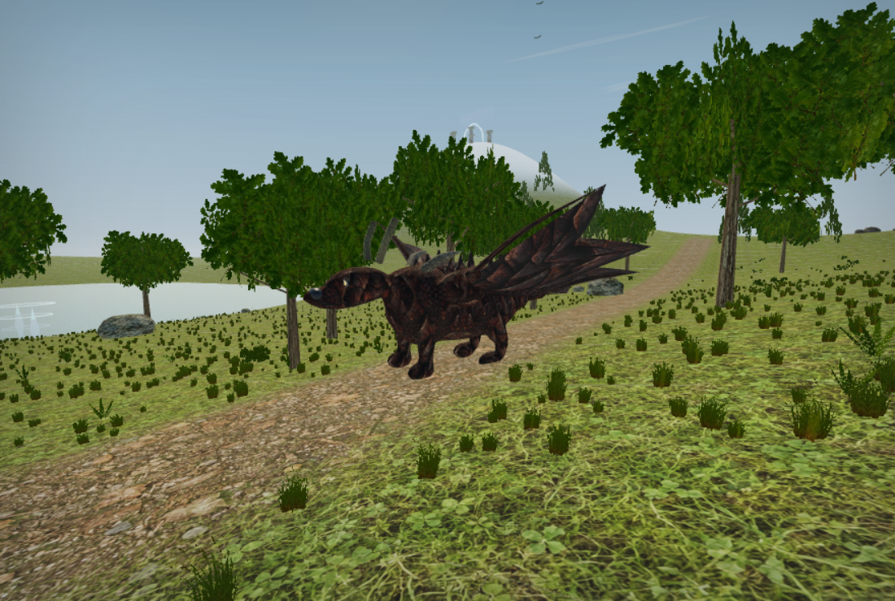
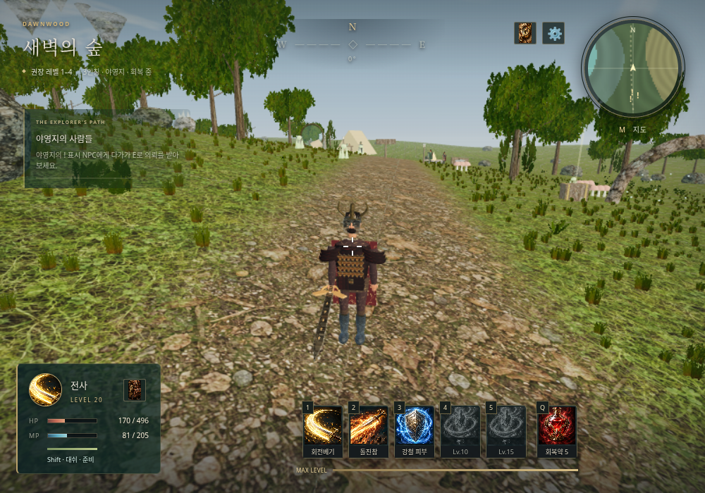

# AETHERWILD · 에테르와일드

자연을 탐험하며 성장하는 **브라우저용 3D 1·3인칭 싱글플레이 판타지 RPG**입니다. 현재 버전은 **v0.6 — Forged Forms**입니다. 숲과 호수, 고원, 설산, 잿불 황무지, 구름 정원을 로딩 없이 오갑니다. 3D 모델·지형·식생·무기·이펙트는 직접 코드로 만들고, 전리품·장비·스킬 아이콘 86개, 캐릭터 초상화 6개와 재질 20종, 전투 효과 원화 4종은 이 프로젝트용으로 새로 생성했습니다. 외부 스톡 그래픽 팩은 사용하지 않습니다.

## v0.6 변경 사항

- **아이템별 착용 외형**: 무기 9종·공용 갑옷 3종·직업 방어구 24종을 개별 모델로 표시. 상의와 별도로 투구·장갑·신발의 등급을 판정하며, 장착/해제는 1인칭 장갑·무기와 F1 전신 모델에 즉시 반영
- **공격 동작**: 전사 3단 기본 베기, 큰 회전과 내려찍기, 0.38초 힘을 모은 뒤 실제로 이동하며 타격하는 돌진참. 마법사는 지팡이를 들어올려 범위 마법을 펼치고 기본 구체를 밀어내며 시전. 궁수는 활 당김과 광역 사격을 구분
- **프로필에 맞춘 인체**: 약 7.6등신, 어깨·허리·팔꿈치·손목·무릎을 구분. 전사 붉은 망토, 궁수 녹색 후드, 여성 마법사 긴 흑발·별무늬 남색 로브, NPC별 복장과 머리·수염
- **전체 몬스터 재디자인**: 눈꺼풀·세로 동공·치열·턱·갈기·갑각·석판·깃털·발톱. 비룡의 관자뿔·등비늘·부채형 날개막. 표면 이음새와 곡선/의복 면 방향 보정
- **신규 몬스터 5종**: 가시 낫사마귀 Lv.6 / 심연 유리뱀 Lv.10 / 월광 스핑크스 Lv.14 / 용암 갑주거미 Lv.16 / 폭풍 왕관조 Lv.19. 기존 12종과 합쳐 총 17종, 각 서식지와 드랍 테이블에 통합
- **마법사 텔레포트 쿨타임 삭제**: 매회 MP 15와 장애물 판정 유지
- **그림자사냥꾼 10레벨 스킬 교체**: 독화살 삭제 → 그림자 화살 폭풍. 숫자 4로 즉시 전방 10m 지점의 반경 8m 광역 공격(380%, MP 25, 재사용 10초). 15레벨 암살 표식 유지
- [모델·장비·모션·신규 생물 설계](docs/FORGED_FORMS.md)

## v0.5 변경 사항

- **독립 세이브 5칸**: 시작 화면에서 칸 선택 → 새 여정/이어하기. 구버전 저장은 원본을 보존하며 1번 칸으로 자동 이전
- **테스트 배율**: 처치·채집·상자·의뢰·탐험 경험치 ×5. 몬스터에 직업 장비 드랍 추가, 장비 확률 ×5(최대 100%). 도감에서 기본/적용 확률 확인
- **전사 Shift 대쉬**: 0.18초 동안 4.5m, 기력 24, 재사용 1.2초. **마법사 Shift 텔레포트**: 최대 6m, MP 15, 재사용 2.5초. 장애물 앞에서 정지. 궁수 Shift 달리기 유지
- **궁수**: 연속 충돌 판정으로 적들을 관통하는 화살, 커진 투사체, 당길 때 중력을 반영한 예상 궤적, 비행 잔상, 중앙이 빈 흰색 대칭 십자 조준점
- **마법사 기본 공격**: 텍스처가 들어간 마력구체를 발사하여 첫 대상에 적중. 숫자 키의 공격 스킬은 지면 범위 마법 유지
- **생물 모델 개편**: 12종의 해부·실루엣·재질 사양을 먼저 정의하고 연속 표면 메시와 뼈대 변형 적용. 새 털·비늘·점액막·피부 이미지, 얼굴·복장 개선
- **전투 효과**: 새 마력구체·검격·접촉 타격·텔레포트 원화. 몬스터 표면의 타격 섬광과 기본/스킬 이펙트에 반영
- **구름 정원**: 야영지 동쪽의 차원문으로 입장. 고도 66~100m의 섬 8개, 일반 점프로 건너는 다섯 구간, 등반줄 두 구간, 새 몬스터 3종, 채집과 숨겨진 상자
- **지역별 판타지 랜드마크**: 세계수 빛의 뿌리, 역중력 물 고리, 부유 암편, 오로라 수정 아치, 흑요석 용암맥과 구름섬
- [생물 디자인 사양·지역별 컨셉·구름 정원 안내](docs/CLOUD_GARDEN.md)

## v0.4 변경 사항

- **전사 캔슬 전투**: 기본 공격 ↔ 스킬 ↔ 스킬의 동작 대기 삭제. 취소된 미발동 공격은 나중에 적중하지 않으며 마나·스킬 재사용 시간은 유지
- **F1 시점 전환**: 플레이어 위치를 유지하는 1인칭 ↔ 3인칭. 장애물 카메라 보정과 Alt+마우스 자유 시점
- **직업별 장비**: 무기·상의·투구·장갑·신발 5슬롯, 새 방어구 24개와 기존 장비 12개. 착용/해제가 능력치와 3D 모델에 반영
- **능력치 배분**: 레벨당 3포인트, 힘·민첩·지능·체력, 공격력·HP/MP·방어·치명타·이동·마나 회복 반영, 무료 초기화
- **원화·재질·UI 개편**: 아이콘 86개, 초상화 6개, 새 재질 12종. 장비 슬롯·능력치 패널·가방·제작·대화·도감·HUD에 통합
- **모델과 전투 효과**: 직업별 전신 모델, 몬스터별 서리 결정·갈기·발톱·날개 뼈대·수호자 문양. 실제 운석 표면·균열·화염 꼬리, 얼음 기둥, 번개, 원소별 타격 효과
- **마을 귀환 주문서**: 일반 몬스터 12%/22%, 보스 100% 드랍. 바닥에서 줍고 **R** 또는 가방에서 사용
- [v0.4 변경 상세와 저장 호환](docs/FORGED_IDENTITY.md)

## v0.3 변경 사항

- 전사: 좌우 연속 베기, 회전베기, 돌진 찌르기, 방어 자세, 버프 발동, 심판·대지 분쇄 내려찍기. **준비 → 타격 → 회복** 동작과 실제 타격 시점 연동
- 전리품: 처치 시 경험치 지급, **아이템·골드는 바닥으로 떨어지는 주머니에서 E로 획득**. 미수거 주머니는 저장·이어하기·부활 후에도 유지
- 몬스터: 관절 다리 보행, 머리·턱·꼬리·날개 움직임, 공격 준비, 피격 반동, 쓰러짐·붕괴·소멸과 재생성
- 그래픽: 푸른 하늘·햇빛·안개, 지면 재질 반복 완화, 고사리, 상세 생물 모델, 높은 품질의 2048 그림자, 모루·약초 작업대·등불
- NPC **레아 / 엘리아 / 토렌**, 대화 창과 **6개 의뢰**. E로 수락하고 목표 달성 후 같은 NPC에게 보고. J에서 진행 확인
- 이전 v0.1/v0.2 캐릭터 저장 데이터와 호환
- [모션·전리품·NPC 업데이트 상세](docs/PEOPLE_OF_THE_WILDS.md)

## v0.2 변경 사항

- 자연스러운 숲 지면 재질, 목재·암석·가죽 법선 맵, 바람에 흔들리는 잎과 풀, 대기 하늘과 물 반사
- 궁수: **좌클릭 유지로 활 당김 → 놓으면 발사**. 숫자 키로 다음 화살을 변경하고 발사 시 마나·쿨다운 소모
- 마법사: **숫자 키로 지면 범위 선택 → 좌클릭 확정**, 우클릭 취소. 공격 스킬과 기본 공격은 범위 판정
- 능력 아이콘 25개, 인벤토리·제작·스킬 창과 HUD, 활 당김 게이지, 원소별 이펙트 새 제작
- [그래픽·전투 개편 상세](docs/ART_DIRECTION.md)

이미 같은 Codespaces에서 이전 버전을 실행했다면 터미널에서 **Ctrl+C**로 서버를 종료하고 다음을 실행하세요. 파일 변경이 있으면 먼저 보존하세요.

```bash
git switch codex/aetherwild-v0.1.0
git pull --ff-only
bash play.sh
```

`play.sh`가 변경된 소스·재질을 확인해 필요한 빌드를 갱신합니다. 브라우저에서 새로고침하면 됩니다. 기존 브라우저 저장 데이터는 유지합니다.

## 화면





## 실행 패키지 다운로드

[게임 ZIP 받기](downloads/README.md) — 소스 코드와 바로 실행할 수 있는 빌드본이 함께 들어 있습니다.

## 실행

Node.js **20.19 이상**(권장 22 또는 24)과 WebGL 2를 지원하는 PC 브라우저가 필요합니다.

```bash
npm ci
npm run dev
```

GitHub Codespaces에서는 위 명령을 게임 폴더에서 실행한 뒤 **포트(Ports) 탭 → 5173 → 브라우저에서 열기**를 선택하세요. 게임 페이지에서 저장 칸과 직업을 고르고 **새로운 여정**을 누르면 마우스가 게임 안에 고정됩니다. `Esc`로 마우스를 해제할 수 있습니다. 자동 저장은 접속한 브라우저와 주소별로 따로 보관됩니다.

이 프로젝트를 ZIP으로 받았다면 압축을 풀고 `package.json`이 있는 폴더에서 실행하세요. Codex 작업 환경과 Codespaces의 파일은 자동으로 동기화되지 않습니다. 현재 작업 파일을 Codespaces에 옮기거나 GitHub에 커밋·푸시해야 다른 환경에서도 같은 코드를 사용할 수 있습니다.

### 빌드된 게임만 실행

함께 제공되는 ZIP의 `dist`는 라이브러리를 포함한 배포용 빌드입니다. Node 패키지 설치 없이도 Python이 있다면 다음으로 실행할 수 있습니다.

```bash
python3 -m http.server 5173 --bind 0.0.0.0 --directory dist
```

더 간단하게는 게임 폴더에서 `bash play.sh`를 실행하세요. 기본 포트는 5173이며 `bash play.sh 4173`처럼 바꿀 수 있습니다. 빌드가 없으면 의존성 설치와 빌드를 먼저 수행합니다.

`dist/index.html`을 파일로 직접 열지 말고 HTTP 서버로 실행하세요. Codespaces에서는 동일하게 포트 5173을 브라우저에서 열면 됩니다.

### 빌드와 검증

```bash
npm test
npm run build
npm run preview
```

`preview`는 포트 4173을 사용합니다. `npm test`는 전리품 확률·수거, NPC 의뢰, 모션 곡선, 성장, 제작, 소비, 장비, 전직, 저장과 지형을 검사합니다.

선택적으로 실제 브라우저 검증을 재실행할 수 있습니다. 개발 서버가 실행된 상태에서 Python Playwright와 Chromium을 준비하고 다음을 실행하세요.

```bash
python3 -m pip install playwright
# 시스템 Chromium이 없다면 설치 후 CHROMIUM_PATH에 실행 파일 경로를 지정하세요.
CHROMIUM_PATH=/usr/bin/chromium python3 tests/browser_smoke.py
CHROMIUM_PATH=/usr/bin/chromium python3 tests/browser_combat.py
CHROMIUM_PATH=/usr/bin/chromium python3 tests/browser_revision.py
CHROMIUM_PATH=/usr/bin/chromium python3 tests/browser_adventure.py
CHROMIUM_PATH=/usr/bin/chromium python3 tests/browser_identity.py
CHROMIUM_PATH=/usr/bin/chromium python3 tests/browser_cloud_garden.py
CHROMIUM_PATH=/usr/bin/chromium python3 tests/browser_forged_forms.py
CHROMIUM_PATH=/usr/bin/chromium python3 tests/browser_creature_art.py
```

`GAME_URL`로 서버 주소, `GAME_ARTIFACTS`로 스크린샷 저장 경로를 바꿀 수 있습니다. 브라우저 테스트는 격리된 브라우저의 테스트 캐릭터를 사용하며, 개발 서버에서만 제공되는 테스트 접근점을 사용합니다. 프로덕션 빌드에는 해당 접근점이 없습니다.

## 조작

| 입력 | 행동 |
|---|---|
| WASD / 방향키 | 이동 |
| 마우스 / 좌클릭 | 시점 / 전사 공격 · 궁수 누른 채 당기고 놓아 발사 · 마법사 마력구체 / 선택한 범위 확정 |
| 우클릭 | 피해 감소 방어, 궁수는 추가 조준 |
| F1 | 1인칭 ↔ 3인칭 |
| Alt + 마우스 | 3인칭 자유 시점 |
| R | 마을 귀환 주문서 1개 사용 |
| Space | 점프, 물에서 헤엄치기 |
| 왼쪽 Shift | 전사: 대쉬 / 마법사: 텔레포트 / 궁수: 달리기 |
| 1–5 | 전사 스킬 · 궁수 화살 변경/회복 · 마법사 범위 선택/회복. 그림자사냥꾼 4는 즉시 광역 공격 |
| E | NPC / 줍기 / 채집 / 상자 / 차원문 / 줄잡기·놓기 |
| W / S (줄타기 중) | 오르기 / 내려가기 · Space로 뛰어내리기 |
| Q | 회복약 사용 |
| I / C / K | 소지품 / 제작 / 스킬·전직 |
| M / J | 지도 / 탐험·몬스터 도감 |
| Esc / Tab | 일시 정지, 마우스 해제 |

## 첫 모험 안내

1. 저장 칸 **1~5** 중 하나를 고르고 **전사 / 궁수 / 마법사** 중 하나를 선택합니다. 회복약 5개와 마나약 3개를 가지고 시작합니다.
2. 먼저 야영지의 **레아·엘리아·토렌**에게 다가가 `E`로 의뢰를 받아 보세요. 야영지 주변에서 `E`로 약초·버섯·목재·철을 모으고, 숲의 이끼 슬라임부터 사냥하세요. 기본 공격은 자원을 소모하지 않습니다. 스킬 1은 첫 레벨부터 사용할 수 있습니다. 궁수는 숫자 1로 관통화살을 장전한 뒤 좌클릭을 누르고 놓아 발사합니다. 마법사는 숫자 1로 불꽃의 장을 선택하고 지면을 겨눈 뒤 좌클릭합니다.
3. 몬스터가 남긴 주머니에 다가가 **E로 아이템과 골드를 획득**하세요. `J`에서 NPC 의뢰·탐험 목표·드랍 확률을 확인합니다. **NPC 의뢰는 의뢰인에게 돌아가 완료 보고**해야 보상을 받습니다. 별도의 탐험 업적은 자동 지급됩니다. `M`에서 지역과 권장 레벨을 볼 수 있습니다.
4. `C`로 장비·요리·물약을 만들고 `I`에서 장착·사용하세요. 요리는 체력 회복과 공격력 증가를 제공합니다. 가방의 마나약도 클릭하여 사용할 수 있습니다.
5. 4/7레벨에 기본 직업 스킬, 10레벨에 2차 전직과 첫 전직 스킬, 15레벨에 궁극기가 열립니다. 전직은 **처음 야영지 근처**에서 `K`를 눌러 선택하세요.
6. 고원과 설산에서 장비를 강화하고 잿불 황무지의 **20레벨 고대 수호자**에 도전하세요. 몬스터는 40초, 채집물은 90초 후 재생합니다. 상자는 한 번만 열립니다.

야영지는 안전 지역이며 빠르게 회복합니다. 전투가 끝나면 필드에서도 체력이 천천히 회복되고 마나는 계속 재생합니다. 사망하면 아이템은 보존되고 현재 경험치의 15%만 잃습니다. 메뉴를 열거나 마우스를 해제하면 게임이 일시 정지됩니다.

## 포함된 시스템

- 결정적 시드로 생성한 640×640m 월드, 최고 100m의 부유섬, 지형별 식생·눈·물·유적과 숨겨진 상자 9개
- 17종 몬스터, 레벨 1–20, 관절 보행·공격 준비·피격·사망·복귀·재생성, 우두머리, 투사체와 범위 공격
- NPC 3명, 선행 조건이 있는 의뢰 6개, 납품·처치·제작, 직접 보고하는 보상과 진행 저장
- 물리적으로 떨어지는 전리품 주머니와 E 수거, 미수거 전리품 저장
- 세 직업, 여섯 2차 전직, 직업별 기본 스킬 3개와 전직별 스킬 2개
- 독립 확률 전리품, 인벤토리와 장비 능력치, 채집, 대장·요리·연금술 제작식 38개
- 중력·점프·지면 접촉·나무와 바위 충돌·수영·달리기·기력·낙하 피해
- 장비 5슬롯, 직업별 방어구, 레벨당 능력치 배분, 귀환 주문서
- 지도·미니맵·도감·목표 보상, 5칸 자동 저장·이어하기·저장 파일 내보내기/가져오기
- 낮음/높음 그래픽 설정, 직접 합성한 효과음 켜기/끄기 (기본 꺼짐)

## 설계 문서와 코드

- [개발 계획](docs/DEVELOPMENT_PLAN.md): 범위, 제작 순서, 지역·직업·드랍 설계
- [콘텐츠 수치표](docs/CONTENT_REFERENCE.md): 코드에서 생성한 스킬·드랍·제작 정본
- `src/sky-layout.js` / `src/fantasy-world.js`: 부유섬·등반줄·지역별 랜드마크
- `src/sculpt.js` / `src/creatures.js`: 연속 표면 메시 생성과 몬스터 뼈대
- `src/save-slots.js`: 5칸 저장·구버전 이전·선택 칸 관리
- `src/data.js`: 콘텐츠 수치와 제작식
- `src/state.js`: 성장·인벤토리·전직·저장 규칙
- `src/quests.js` / `src/quest-data.js`: NPC 의뢰·보상·선행 조건
- `src/actors.js` / `src/motion.js`: 관절 모델과 전사·몬스터 애니메이션
- `src/ground-loot.js` / `src/loot.js`: 전리품 낙하·수거·직렬화
- `src/terrain.js` / `src/world.js`: 지형과 직접 제작한 3D 모델
- `src/equipment-data.js`: 직업별 장비·제작식·능력치 정의
- `src/gear-visuals.js` / `src/modeling.js`: 아이템별 외형 사양·직접 설계한 단면/곡선/판 메시
- `src/creature-detail.js`: 17종의 눈·치열·갑각·석판·익막·깃털
- `src/avatar.js` / `src/camera.js`: 착용 장비를 반영하는 전신 모델·3인칭 카메라
- `src/spell-art.js` / `src/surfaces.js`: 스킬별 3D 효과·새 재질
- `src/engine.js`: 이동·물리·전투·상호작용·렌더링
- `src/main.js` / `src/style.css`: 게임 UI

## 현재 범위와 알려진 제약

현재 버전은 자연 재질을 적용한 절차적 3D 싱글플레이 RPG입니다. 전직·성장·최종 보스까지 이어지는 플레이 루프가 있으며, 대규모 상용 RPG의 콘텐츠 분량이나 스캔 기반 실사 그래픽을 제공하는 버전은 아닙니다. 캐릭터는 코드로 만든 관절 모델과 절차적 애니메이션을 사용하고 물리는 캡슐 근사/높이 지형 기반으로, 동굴·벽 오르기·파괴 가능한 지형은 없습니다. 일부 몬스터의 장애물 우회는 단순하며 장거리 경로 탐색은 없습니다. 멀티플레이, 서버 계정, 모바일 터치 조작은 포함하지 않습니다.

키보드·마우스와 WebGL 2, Pointer Lock이 필요합니다. 임베디드 미리보기에서 입력이 막히면 페이지를 별도 브라우저 탭으로 여세요. 성능이 낮으면 메뉴 → 설정 → 그래픽 품질을 **낮음**으로 바꾸세요. 자동 저장은 브라우저 저장 공간을 사용하며, 설정에서 JSON 파일로 백업하고 가져올 수 있습니다.
