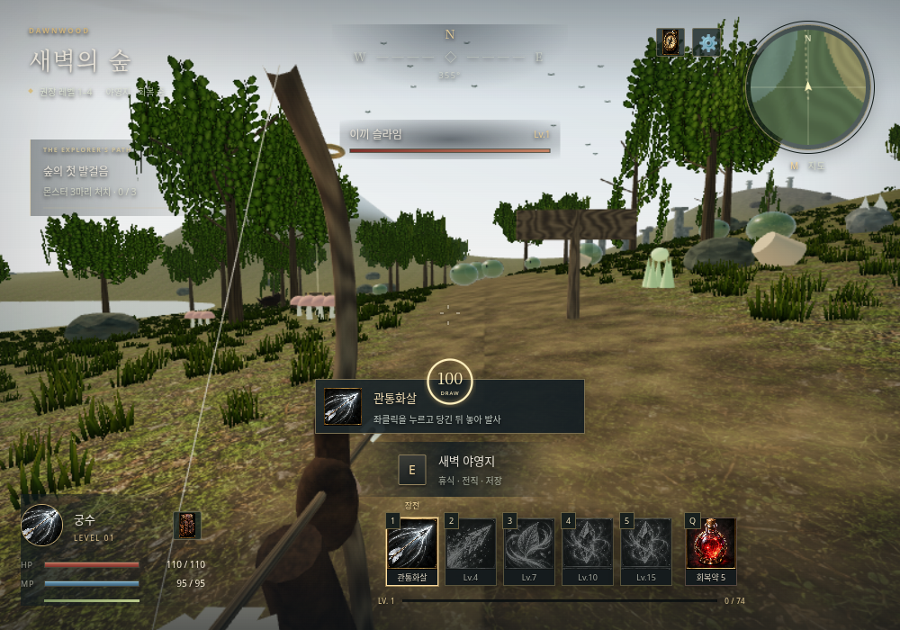
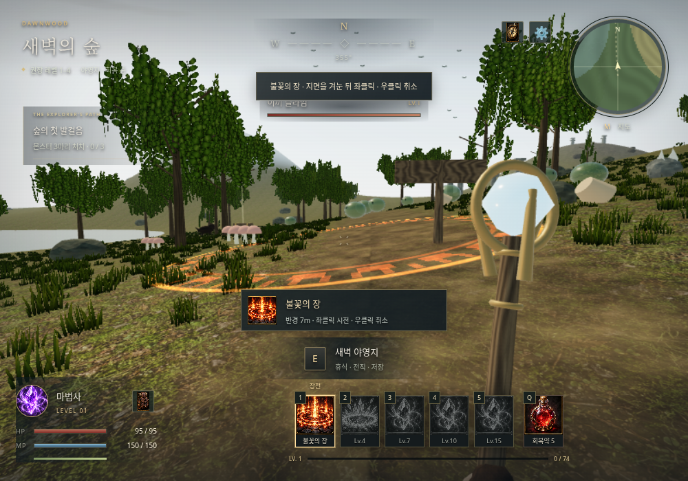

# AETHERWILD · 에테르와일드

자연을 탐험하며 성장하는 **브라우저용 3D 1인칭 싱글플레이 판타지 RPG**입니다. 현재 버전은 **v0.2 — Wilderness & Combat**입니다. 숲과 호수, 고원, 설산, 잿불 황무지를 로딩 없이 오갑니다. 3D 모델·지형·식생·무기·이펙트는 직접 코드로 만들고, 숲 재질과 25종 능력 아이콘은 이 프로젝트용으로 새로 생성했습니다. 외부 스톡 그래픽 팩은 사용하지 않습니다.

## v0.2 변경 사항

- 자연스러운 숲 지면 재질, 목재·암석·가죽 법선 맵, 바람에 흔들리는 잎과 풀, 대기 하늘과 물 반사
- 궁수: **좌클릭 유지로 활 당김 → 놓으면 발사**. 숫자 키로 다음 화살을 변경하고 발사 시 마나·쿨다운 소모
- 마법사: **숫자 키로 지면 범위 선택 → 좌클릭 확정**, 우클릭 취소. 공격 스킬과 기본 공격은 범위 판정
- 능력 아이콘 25개, 인벤토리·제작·스킬 창과 HUD, 활 당김 게이지, 원소별 이펙트 새 제작
- [그래픽·전투 개편 상세](docs/ART_DIRECTION.md)

이미 같은 Codespaces에서 v0.1을 실행했다면 터미널에서 **Ctrl+C**로 서버를 종료하고 다음을 실행하세요. 파일 변경이 있으면 먼저 보존하세요.

```bash
git switch codex/aetherwild-v0.1.0
git pull --ff-only
bash play.sh
```

`play.sh`가 변경된 소스·재질을 확인해 필요한 빌드를 갱신합니다. 브라우저에서 새로고침하면 됩니다. 기존 브라우저 저장 데이터는 유지합니다.

## 화면





## 실행 패키지 다운로드

[게임 ZIP 받기](downloads/README.md) — 소스 코드와 바로 실행할 수 있는 빌드본이 함께 들어 있습니다.

## 실행

Node.js **20.19 이상**(권장 22 또는 24)과 WebGL 2를 지원하는 PC 브라우저가 필요합니다.

```bash
npm ci
npm run dev
```

GitHub Codespaces에서는 위 명령을 게임 폴더에서 실행한 뒤 **포트(Ports) 탭 → 5173 → 브라우저에서 열기**를 선택하세요. 게임 페이지에서 직업을 고르고 **새로운 여정**을 누르면 마우스가 게임 안에 고정됩니다. `Esc`로 마우스를 해제할 수 있습니다. 자동 저장은 접속한 브라우저와 주소별로 따로 보관됩니다.

이 프로젝트를 ZIP으로 받았다면 압축을 풀고 `package.json`이 있는 폴더에서 실행하세요. Codex 작업 환경과 Codespaces의 파일은 자동으로 동기화되지 않습니다. 현재 작업 파일을 Codespaces에 옮기거나 GitHub에 커밋·푸시해야 다른 환경에서도 같은 코드를 사용할 수 있습니다.

### 빌드된 게임만 실행

함께 제공되는 ZIP의 `dist`는 라이브러리를 포함한 배포용 빌드입니다. Node 패키지 설치 없이도 Python이 있다면 다음으로 실행할 수 있습니다.

```bash
python3 -m http.server 5173 --bind 0.0.0.0 --directory dist
```

더 간단하게는 게임 폴더에서 `bash play.sh`를 실행하세요. 기본 포트는 5173이며 `bash play.sh 4173`처럼 바꿀 수 있습니다. 빌드가 없으면 의존성 설치와 빌드를 먼저 수행합니다.

`dist/index.html`을 파일로 직접 열지 말고 HTTP 서버로 실행하세요. Codespaces에서는 동일하게 포트 5173을 브라우저에서 열면 됩니다.

### 빌드와 검증

```bash
npm test
npm run build
npm run preview
```

`preview`는 포트 4173을 사용합니다. `npm test`는 전리품 확률, 성장, 제작, 소비, 장비, 전직, 저장과 지형을 검사합니다.

선택적으로 실제 브라우저 검증을 재실행할 수 있습니다. 개발 서버가 실행된 상태에서 Python Playwright와 Chromium을 준비하고 다음을 실행하세요.

```bash
python3 -m pip install playwright
# 시스템 Chromium이 없다면 설치 후 CHROMIUM_PATH에 실행 파일 경로를 지정하세요.
CHROMIUM_PATH=/usr/bin/chromium python3 tests/browser_smoke.py
CHROMIUM_PATH=/usr/bin/chromium python3 tests/browser_combat.py
CHROMIUM_PATH=/usr/bin/chromium python3 tests/browser_revision.py
```

`GAME_URL`로 서버 주소, `GAME_ARTIFACTS`로 스크린샷 저장 경로를 바꿀 수 있습니다. 브라우저 테스트는 격리된 브라우저의 테스트 캐릭터를 사용하며, 개발 서버에서만 제공되는 테스트 접근점을 사용합니다. 프로덕션 빌드에는 해당 접근점이 없습니다.

## 조작

| 입력 | 행동 |
|---|---|
| WASD / 방향키 | 이동 |
| 마우스 / 좌클릭 | 시점 / 전사 공격 · 궁수 누른 채 당기고 놓아 발사 · 마법사 범위 확정 |
| 우클릭 | 피해 감소 방어, 궁수는 추가 조준 |
| Space | 점프, 물에서 헤엄치기 |
| 왼쪽 Shift | 달리기, 기력 소모 |
| 1–5 | 전사 스킬 · 궁수 화살 변경/회복 · 마법사 범위 선택/회복 |
| E | 채집 / 상자 열기 / 야영지 |
| Q | 회복약 사용 |
| I / C / K | 소지품 / 제작 / 스킬·전직 |
| M / J | 지도 / 탐험·몬스터 도감 |
| Esc / Tab | 일시 정지, 마우스 해제 |

## 첫 모험 안내

1. **전사 / 궁수 / 마법사** 중 하나를 선택합니다. 회복약 5개와 마나약 3개를 가지고 시작합니다.
2. 야영지 주변에서 `E`로 약초·버섯·목재·철을 모으고, 숲의 이끼 슬라임부터 사냥하세요. 기본 공격은 자원을 소모하지 않습니다. 스킬 1은 첫 레벨부터 사용할 수 있습니다. 궁수는 숫자 1로 관통화살을 장전한 뒤 좌클릭을 누르고 놓아 발사합니다. 마법사는 숫자 1로 불꽃의 장을 선택하고 지면을 겨눈 뒤 좌클릭합니다.
3. `J`에서 탐험 목표와 몬스터별 드랍 확률을 확인하세요. 목표 보상은 자동 지급됩니다. `M`에서 지역과 권장 레벨을 볼 수 있습니다.
4. `C`로 장비·요리·물약을 만들고 `I`에서 장착·사용하세요. 요리는 체력 회복과 공격력 증가를 제공합니다. 가방의 마나약도 클릭하여 사용할 수 있습니다.
5. 4/7레벨에 기본 직업 스킬, 10레벨에 2차 전직과 첫 전직 스킬, 15레벨에 궁극기가 열립니다. 전직은 **처음 야영지 근처**에서 `K`를 눌러 선택하세요.
6. 고원과 설산에서 장비를 강화하고 잿불 황무지의 **20레벨 고대 수호자**에 도전하세요. 몬스터는 40초, 채집물은 90초 후 재생합니다. 상자는 한 번만 열립니다.

야영지는 안전 지역이며 빠르게 회복합니다. 전투가 끝나면 필드에서도 체력이 천천히 회복되고 마나는 계속 재생합니다. 사망하면 아이템은 보존되고 현재 경험치의 15%만 잃습니다. 메뉴를 열거나 마우스를 해제하면 게임이 일시 정지됩니다.

## 포함된 시스템

- 결정적 시드로 생성한 640×640m 월드, 약 65m의 고저차, 지형별 식생·눈·물·유적과 숨겨진 상자 8개
- 9종 몬스터, 레벨 1–20, 추격·공격·복귀·재생성, 우두머리, 투사체와 범위 공격
- 세 직업, 여섯 2차 전직, 직업별 기본 스킬 3개와 전직별 스킬 2개
- 독립 확률 전리품, 인벤토리와 장비 능력치, 채집, 대장·요리·연금술 제작식 14개
- 중력·점프·지면 접촉·나무와 바위 충돌·수영·달리기·기력·낙하 피해
- 지도·미니맵·도감·목표 보상, 자동 저장·이어하기·저장 파일 내보내기/가져오기
- 낮음/높음 그래픽 설정, 직접 합성한 효과음 켜기/끄기 (기본 꺼짐)

## 설계 문서와 코드

- [개발 계획](docs/DEVELOPMENT_PLAN.md): 범위, 제작 순서, 지역·직업·드랍 설계
- [콘텐츠 수치표](docs/CONTENT_REFERENCE.md): 코드에서 생성한 스킬·드랍·제작 정본
- `src/data.js`: 콘텐츠 수치와 제작식
- `src/state.js`: 성장·인벤토리·전직·저장 규칙
- `src/terrain.js` / `src/world.js`: 지형과 직접 제작한 3D 모델
- `src/engine.js`: 이동·물리·전투·상호작용·렌더링
- `src/main.js` / `src/style.css`: 게임 UI

## 현재 범위와 알려진 제약

현재 버전은 자연 재질을 적용한 절차적 3D 싱글플레이 RPG입니다. 전직·성장·최종 보스까지 이어지는 플레이 루프가 있으며, 대규모 상용 RPG의 콘텐츠 분량이나 사실적인 그래픽·애니메이션을 목표로 하지 않습니다. 캐릭터는 코드로 만든 단순 모델이고 물리는 캡슐 근사/높이 지형 기반으로, 동굴·벽 오르기·파괴 가능한 지형은 없습니다. 일부 몬스터의 장애물 우회는 단순하며 장거리 경로 탐색은 없습니다. 멀티플레이, 서버 계정, 모바일 터치 조작은 포함하지 않습니다.

키보드·마우스와 WebGL 2, Pointer Lock이 필요합니다. 임베디드 미리보기에서 입력이 막히면 페이지를 별도 브라우저 탭으로 여세요. 성능이 낮으면 메뉴 → 설정 → 그래픽 품질을 **낮음**으로 바꾸세요. 자동 저장은 브라우저 저장 공간을 사용하며, 설정에서 JSON 파일로 백업하고 가져올 수 있습니다.
